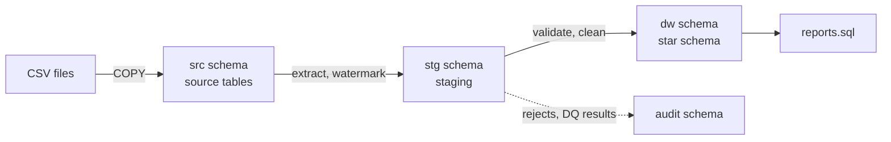

# ETL Data Warehouse in PostgreSQL

An end-to-end data-warehouse project: a messy ERP-style source system (customers, items, invoices, headquarters,
states), a Python/SQL **ETL pipeline** that cleans it, a **star schema** with **SCD Type 2** customer history, and a
**benchmark** of indexing and partitioning. Everything is synthetic and runs on a laptop with Docker.

## What it demonstrates

- **Dimensional modeling**: one fact table (one row per invoice line) plus customer, product, geography and date dimensions
- **SCD Type 2**: customers who change headquarters keep their history, and each sale points at the version valid on its date
- **Incremental loads**: a high-water mark on `POSTING_ID` picks up new rows, including late-arriving ones
- **Idempotent upserts**: re-running a batch changes nothing, so revenue is never double-counted
- **Data quality**: 11 automated checks and reconciliation, a rejected-rows table, and an audit log for every run
- **Safe failure**: each run is one transaction; an error rolls everything back and records the run as `FAILED`
- **Performance work**: `EXPLAIN ANALYZE` benchmarks on 2.6M and 5.2M rows

## Architecture



Star schema (details and ER diagram in [docs/warehouse_design.md](docs/warehouse_design.md)):
`fact_sales_line` joined to `dim_date`, `dim_customer` (SCD2), `dim_product`, and `dim_geography` (through the customer).

## Results

| Test | Result |
|---|---|
| Initial load | 122,431 lines staged, 263 rejected, 122,168 loaded |
| October batch | 6,857 new lines, 40 customer versions closed and 100 inserted, 15 re-sent postings skipped |
| Re-run of a batch, even with the watermark off | 0 rows changed |
| Revenue check | warehouse total equals the source line total exactly |
| Header totals | 549 source mismatches fall to the 135 corrupted headers once line amounts are corrected |
| Invoice lookup, 2.6M rows | 198 ms → 0.01 ms with an index |
| Customer history, 2.6M rows | 231 ms → 1.7 ms (134x) with a covering index |
| Monthly partitioning | no query speedup at this size, so it is not enabled (see [docs/performance.md](docs/performance.md)) |

Timings are from a single-core sandbox with default PostgreSQL settings; run the benchmark to get numbers for your own machine.

## Quick start

Requires Docker Desktop and Python 3.10+.

```bash
docker compose up -d                         # PostgreSQL 16 with the source tables loaded (port 5433)
pip install -r requirements.txt
python etl/run_etl.py --reset                # initial load

# incremental load of the October batch
docker compose exec db psql -U etl -d warehouse -f /docker-entrypoint-initdb.d/batch2/load_batch2.sql
python etl/run_etl.py --source-schema src_batch2 --effective-date 2026-10-01

# optional
python benchmark/run_benchmark.py            # indexing/partitioning benchmark (about 2-5 min)
```

Connect with any SQL client: host `localhost`, port `5433`, database `warehouse`, user `etl`, password `etl`
(a local demo credential). Sample reports: `sql/warehouse/reports.sql`.

## Repository layout

```
data/                 source CSVs (initial load) and data/batch_2/ (October increment)
answer_key/           every planted data problem and batch-2 change
sql/postgres/         source schema + COPY load (used by docker-compose)
sql/sqlserver/        the same source tables for SQL Server (T-SQL, untested)
sql/warehouse/        staging + star schema DDL, ETL steps, sample reports
etl/run_etl.py        ETL runner
benchmark/            benchmark script, SQL, and saved results
docs/                 dataset guide, warehouse design, performance write-up
generate_dataset.py   regenerates the dataset (seed 42)
tools/verify_dataset.py   checks the dataset against the answer key
```

## Documentation

- [Warehouse and ETL design](docs/warehouse_design.md): flow, ER diagram, decisions, how each data problem is handled
- [Performance](docs/performance.md): benchmark method, results, and why partitioning was not adopted
- [Dataset guide](docs/dataset.md): tables, planted data problems, batch 2 events

## Tech

PostgreSQL 16 · SQL (CTEs, lateral joins, `ON CONFLICT` upserts) · Python 3 (`psycopg2`) · Docker Compose

## Notes

All data is synthetic. The ETL and warehouse are written for PostgreSQL; the SQL Server scripts only load the source tables.
