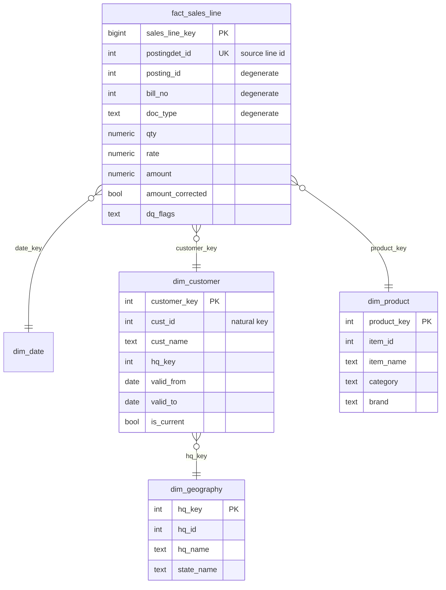

# Warehouse & ETL design

## Flow

```
src / src_batch2  --(extract, watermark)-->  stg  --(validate, clean, load)-->  dw  (+ audit.*)
```

`etl/run_etl.py` runs the SQL steps in `sql/warehouse/` in order inside **one transaction**: any failure rolls the
whole batch back and the run is kept in `audit.etl_run` as `FAILED` with the error text.

| Step file | What it does |
|---|---|
| 00_ddl | schemas, audit tables, staging, star schema, `dim_date` (2024-2027, Indian fiscal year), "Unknown" members |
| 01_stage | truncate + load staging; postings are extracted above the high-water mark |
| 02_validate | 11 data-quality checks written to `audit.dq_check_result` |
| 03_dim_geography | state de-duplication, HQ name standardisation, bad HQs to `audit.rejected_rows` |
| 04_dim_product | category and brand derived from the item name, Type 1 upsert |
| 05_dim_customer | SCD Type 2 |
| 06_fact_sales_line | zero-qty lines rejected, amounts recalculated, SCD2-aware key lookup, idempotent upsert |
| 07_reconcile_and_watermark | reconciliation checks, advance the watermark |

## Star schema



Grain: one row per invoice line. Key `0` is the **Unknown** member in every dimension.

## Design decisions

- **SCD Type 2 only where history matters**: `dim_customer` tracks name, `CSBC` and HQ. `BILL_AMOUNT` is a running
  total, so it is *not* tracked; compute it from the fact.
- **Customer key by posting date**: each fact line points at the customer version valid on its posting date,
  so late-arriving September postings from a customer who moved in October still show the old HQ.
- **New customers start at 1900-01-01** so that late-arriving history resolves to a version.
- **Type 1 for geography and product**: renames overwrite in place (`Amritsar` becomes `Amritsar HQ`).
- **Watermark on `POSTING_ID`, not on date**: a date watermark would miss the 25 late-arriving postings.
- **Idempotent facts**: `ON CONFLICT (postingdet_id) DO UPDATE ... WHERE <something changed>`, so re-sent rows touch nothing.
- **Covering indexes on the fact** (`date_key` and `customer_key, date_key`, with `INCLUDE`), chosen by benchmark.
- **Facts are at line grain**; the header `BILL_AMOUNT` is only used in a reconciliation check.

## How each seeded problem is handled

| Problem | Handling |
|---|---|
| Orphan customer / item on a posting | kept (revenue still counts), points to Unknown member, `dq_flags` set |
| Customer HQ unassigned or not found | customer gets the Unknown geography |
| Name spacing / case | cleaned in `dim_customer` |
| Duplicate state (`'UTTARAKHAND '`) | collapsed to the canonical id through `dw.ref_state_alias` |
| HQ without a state | rejected to `audit.rejected_rows` |
| Zero-quantity line | rejected to `audit.rejected_rows` |
| Line `AMOUNT` ≠ `QTY*RATE` | recalculated, `amount_corrected = true` |
| Header total ≠ sum of lines | reported only; after the line fix, 549 mismatches fall to the 135 corrupted headers |
| Item with no known category | `UNCATEGORIZED` plus an INFO check (add a keyword to `dw.ref_category`) |

## Run it

```bash
pip install -r requirements.txt
export PGHOST=localhost PGPORT=5433 PGUSER=etl PGPASSWORD=etl PGDATABASE=warehouse   # docker-compose defaults

python etl/run_etl.py --reset                                                  # initial load
docker compose exec -T db psql -U etl -d warehouse < sql/postgres/batch2/load_batch2.sql
python etl/run_etl.py --source-schema src_batch2 --effective-date 2026-10-01   # incremental load
python etl/run_etl.py --source-schema src_batch2 --effective-date 2026-10-01 --ignore-watermark   # idempotency test
psql -h localhost -p 5433 -U etl -d warehouse -f sql/warehouse/reports.sql
```

## Tested results (PostgreSQL 16)

| Run | Result |
|---|---|
| Initial load | 122,431 lines staged, 263 rejected, 122,168 loaded, about 10 s |
| Batch 2 | 1,957 new postings (15 re-sent ones skipped by the watermark), 6,857 lines, 40 SCD2 versions closed, 100 inserted |
| Re-run of batch 2 | 0 rows changed |
| Batch 2 with watermark off | 1,972 postings re-read, 0 rows changed |
| Revenue check | warehouse total equals source line total exactly |
| Forced failure | transaction rolled back, run recorded as `FAILED` |

## Performance

Indexing and monthly partitioning were benchmarked on a 2.6M and a 5.2M-row scale-up of the fact table; see
[performance.md](performance.md). Result: covering indexes (now in `00_ddl.sql`) gave 7-130x on report queries and
over 1,000x on invoice lookups; partitioning did not help at this size and is not enabled.

## Next milestones

1. Scheduling (cron or Airflow) and a `tests/` folder.
2. Power BI dashboard on the star schema.
